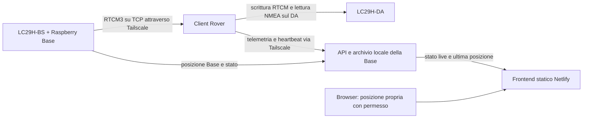

# Architettura RTK Base / Rover

**Stato:** flusso RTCM, FIX da fermo e avvio su richiesta dall'Hub verificati sul Raspberry Rover il 27 novembre 2026.

**Aggiornato:** 27 novembre 2026.

L'HP Ubuntu ospita **Hub dispositivi**. La distribuzione via Netlify/API Base descritta più avanti è una proposta precedente. L'Hub usa HTTP per attendere l'apertura della pagina Rover. Il flusso di correzioni va direttamente dalla Base al Rover via Tailscale.

## Percorsi operativi

| Percorso | Funzione |
| --- | --- |
| Ricevitore Base → seriale Base → TCP `5000` via Tailscale → Raspberry Rover → seriale GNSS Rover | Il riferimento RTCM 1005 e le osservazioni MSM4 arrivano al ricevitore Rover. Nella prova in FLOAT, il GGA del Rover ha riportato stazione `3335` ed età differenziale di 1–2 s. |
| Rover → `GET /api/state` sulla Base → WebSocket Rover → mappa | Aggiorna il marker della Base. Il Rover legge la posizione a intervalli di 5 secondi dopo ogni richiesta. Le coordinate manuali sono facoltative e fungono da riserva. |
| HP → porta `8080` del Rover → socket systemd → server Rover | La prima connessione avvia il servizio. L'Hub aspetta una risposta dalla pagina e poi la apre nel browser. |
| Rover → `POST /api/rover` sulla Base | Invia la telemetria Rover alla Base con `BASE_API_TOKEN`. In una prova è stato registrato HTTP 401 per questo uplink mentre il flusso TCP RTCM continuava. |
| Rover → `POST /api/v1/events` sull'HP | Integrazione opzionale via HTTPS con `ROVER_HUB_URL`, `ROVER_HUB_DEVICE_ID` e `ROVER_HUB_TOKEN`. Invia lo stato circa ogni 10 s e gli indici delle missioni tramite coda SQLite locale. |

La ripartenza dall'Hub e il FIX stabile da fermo sono stati confermati dall'operatore. La causa del precedente FLOAT persistente resta aperta. Per installare il socket e ripetere la prova, segui il [README Rover](../README.md#avvio-su-richiesta-dallhub) e la [guida diagnostica](gap_analisi_risoluzione_GPSRTK.md#verifica-del-27-novembre-2026).

## Aggiornamento dal campo, 20–23 novembre 2026

L'utente ha mostrato `base.service` **active (running)** dal 16 novembre sul Raspberry Base, con `/home/antenna/Documents/base_manager.py` (PID 1521), messaggi RTCM 1005 ripetuti con coordinate `45.9047663, 12.4374086` e porta TCP `0.0.0.0:5000` in ascolto. L'indirizzo Tailscale riportato era `100.85.248.82`; dal Rover `nc -vz -w 3 100.85.248.82 5000` è riuscito. Queste sono osservazioni datate, non una verifica continua del servizio né del contenuto dei frame ricevuti dal Rover.

La UI Rover mostrava **Correzioni RTCM: non configurate** quando `telemetry_server.py` era stato avviato senza `BASE_TAILSCALE_HOST`. Dopo l'avvio manuale con `BASE_TAILSCALE_HOST=100.85.248.82`, `BASE_RTCM_PORT=5000` e le coordinate Base per il marker, l'utente ha riferito di aver ottenuto `FIX`. Il 23 novembre ha riferito di non riuscire a riottenere `FIX`; durante questa verifica la UI mostrava di nuovo **non configurate**, mentre la connessione TCP alla porta 5000 riusciva. Le prove successive descritte nella [guida di riproduzione](riproduzione-traccia.md#stato-del-collaudo-sul-rover) mostrano un avvio del controllore da terminale con FIX, RTCM e IMU; non dimostrano la stabilità del FIX in movimento. La procedura diagnostica è in [Analisi e verifica GPS RTK](gap_analisi_risoluzione_GPSRTK.md#procedura-ripetibile).

Le descrizioni storiche più sotto, che riportano il servizio Base fermo e il nuovo codice non installato, si riferiscono alle verifiche precedenti al 20 novembre. Resta da confrontare il file in esecuzione sulla Base con il sorgente locale byte per byte. Il collaudo del 27 novembre ha verificato il percorso RTCM e la posizione Base sulla mappa Rover.

## Obiettivo concordato

- La Base è un Raspberry Pi 4 con Waveshare LC29H-BS, antenna fissa e Wi-Fi domestico Vodafone.
- Il Rover è un Raspberry Pi 4 con Waveshare LC29H-DA e si collega inizialmente tramite hotspot del telefono; in futuro potrà usare una SIM.
- La Base genera RTCM. Il Rover deve ricevere quei byte, iniettarli nel DA e pubblicare la propria telemetria.
- La pagina deve poter aprirsi con Rover spento, mostrando la Base, la posizione del browser se autorizzata e l'ultima posizione nota del Rover con timestamp e stato offline.
- La pagina statica dovrà poter essere pubblicata su Netlify. Supabase non è richiesto.
- Durante lo sviluppo, PC e Raspberry possono comunicare tramite Tailscale.

## Evidenze sul sistema attuale

### Rover

Il repository `boyz-terminator-main` contiene `telemetry_server.py`, che serve UI e telemetria Rover su HTTP/WebSocket, e `modules/gps.py`, che legge NMEA da `/dev/ttyS0` a 115200 baud. Il modulo interpreta GGA/RMC e lo stato FIX/FLOAT/SINGLE. `modules/rtcm_client.py` mantiene una connessione TCP RTCM con riconnessione e `GPSReader` coordina lettura NMEA e scrittura RTCM sulla stessa seriale. Il server include un uplink HTTP configurabile verso la Base. I controlli del 27 novembre hanno verificato la ricezione delle correzioni e il FIX da fermo con il server avviato su richiesta.

Il server registra ora punti con qualità/freschezza GNSS, RTCM, IMU e comandi motore. L'interfaccia include un trim differenziale persistente applicato prima del driver; le potenze nominali mostrate e quelle effettivamente inviate sono conservate separatamente. La procedura per misurare la relazione comando/velocità è documentata in [Calibrazione motori e dati delle tracce](calibrazione-motori-e-tracce.md). Non è un componente del trasporto RTCM e non prova l'accuratezza della localizzazione.

### Base

Il sorgente operativo fornito dall'utente è `/home/antenna/Documents/base_manager.py`. Una nuova versione locale è nel repository fratello `../boyz-antenna-main/base_manager.py`: legge `/dev/serial0` a 115200 baud, verifica il CRC RTCM, inoltra i frame sulla porta TCP 5000, ricava le coordinate da RTCM 1005/1006 o NMEA GGA e fornisce API HTTP sulla porta 8080. La API memorizza lo stato Base e l'ultima telemetria Rover in SQLite. L'installazione di questa specifica versione sul Raspberry non è confermata.

La lettura manuale della seriale ha mostrato frame con preambolo RTCM3 `D3`; tra gli header osservati compare il tipo 1005, che trasporta il riferimento ECEF della stazione. Questo prova che il ricevitore emette frame compatibili con RTCM3; non prova ancora che il demone TCP funzioni né che il Rover riceva le correzioni.

In una verifica precedente al 20 novembre il servizio remoto `base.service` era in `auto-restart` con `SyntaxError: bytes can only contain ASCII literal characters`, dovuto al carattere Unicode `…` dentro `PAGINA_DI_TEST = b"..."`. L'utente lo aveva poi fermato. La verifica del 20–23 novembre riportata sopra ha invece osservato `base.service` attivo; non è confermato che esegua il sorgente del repository fratello.

Nel testo del sorgente incollato alcune escape appaiono raddoppiate, ad esempio `b"\\xD3"` e `"\\r\\n"`. Se la rappresentazione corrisponde ai byte effettivi del file, il parser cercherebbe i caratteri letterali `\\xD3` invece del preambolo e le risposte HTTP/WebSocket non conterrebbero CRLF reali. Va verificato sul file locale prima di intervenire.

### Persistenza e frontend

Lo stato `posizione_base` del demone Base è in memoria e si perde al riavvio. Il server della Base non riceve né memorizza l'ultima telemetria Rover. Il payload WebSocket Base include campi Rover, IMU e motori impostati a zero: vanno separati o marcati esplicitamente assenti per non presentarli come misure reali.

La UI corrente appartiene al server Rover. Il demone Base prevede una sua pagina statica/test. Il frontend definitivo va separato dai processi Rover e Base, così l'interfaccia resta raggiungibile quando il Rover è spento.

## Architettura obiettivo

### Collegamento RTCM

La Base mantiene un solo lettore seriale, controlla la struttura e il CRC dei frame RTCM3 e li inoltra al client TCP. Il Rover apre una connessione in uscita verso la Base tramite Tailscale, applica riconnessione e stato di freschezza, e scrive i byte RTCM al ricevitore LC29H-DA.

Sul Rover la seriale GPS deve avere un solo proprietario software: lo stesso componente deve coordinare la lettura NMEA e la scrittura RTCM per evitare due processi concorrenti sulla porta. Il flusso RTCM resta distinto dalla telemetria WebSocket/API.

### Stato, ultima posizione e UI

La Base conserva localmente in SQLite la propria posizione di riferimento e l'ultima posizione Rover ricevuta, insieme ai timestamp. L'API espone stato di connessione, età dei dati, qualità RTK e stato delle correzioni. La UI distingue:

- Base fissa e posizione di riferimento;
- posizione del browser, solo dopo il consenso del browser;
- Rover live quando i dati sono freschi;
- ultima posizione Rover con timestamp quando il Rover è spento o disconnesso, usando il marker azzurro-grigio.

Un valore assente deve rimanere `null`/non disponibile, non diventare coordinate `0,0` o telemetria sintetica.

### Tailscale e Netlify

In sviluppo, Rover, Base e PC entrano nella stessa rete Tailscale. Per collegare Rover e Base dietro reti diverse, entrambi i Raspberry devono avere una connessione Tailscale attiva e il Rover deve poter raggiungere l'indirizzo Tailscale della Base.

Netlify può ospitare i file statici, ma non rende pubblici gli IP privati Tailscale. Un browser che non è nella tailnet non potrà raggiungere direttamente le API della Base. Per il rilascio pubblico si dovrà scegliere tra accesso Tailscale anche per il browser o un endpoint/relay raggiungibile pubblicamente e autenticato. L'URL API sarà configurabile, senza IP o credenziali hardcoded nel frontend. Una pagina HTTPS richiede un endpoint dati compatibile con HTTPS/WSS e configurazione CORS limitata all'origine prevista.

Se il requisito futuro comprende l'accesso quando anche il browser non ha Internet, Netlify non basta: serviranno una copia locale della UI sulla Base e risorse di mappa disponibili localmente. Il requisito attuale confermato è invece: Rover spento, browser e Base ancora raggiungibili.

## Gap da chiudere

1. Installare la versione locale Base e verificare avvio, porta TCP 5000, HTTP 8080 e seriale senza conflitti.
2. Verificare in esecuzione CRC e coordinate del messaggio 1005/1006; controllare modalità/parametri survey-in della BS.
3. Installare la versione Rover con variabili d'ambiente Tailscale/API e controllare ricezione RTCM e stato FIX sul DA.
4. Configurare token uplink condiviso, origini CORS e URL API; verificare che il Base salvi e restituisca l'ultima posizione Rover.
5. Configurare `runtime-config.js` per il backend Tailscale/HTTPS e pubblicare `static/` su Netlify.
6. Definire autenticazione/ACL per accesso futuro senza VPN; non esporre le porte di controllo o RTCM direttamente su Internet.

## File d'integrazione aggiunti in locale

### Repository Rover

- `modules/rtcm_client.py`: client TCP con riconnessione, conteggio byte, timestamp correzioni e callback di scrittura sul GPS.
- `modules/gps.py`: aggiunge `write_rtcm()` sullo stesso oggetto seriale che legge NMEA, evitando un secondo processo che apra la porta.
- `telemetry_server.py`: avvia il client RTCM quando `BASE_TAILSCALE_HOST` è impostato e invia una volta al secondo telemetria alla Base.
- `static/index.html` e `static/runtime-config.js`: API Base configurabile, marker Rover conservato/offline azzurro-grigio e stato del flusso RTCM.
- `netlify.toml`: pubblica `static/` come sito statico.

Il widget `Heartbeat Base` mostra l'età (`rover.age_seconds`) dell'ultimo pacchetto Rover ricevuto dalla Base tramite `GET /api/state`: verde quando `rover.online` è vero, grigio con stato offline quando il pacchetto supera la soglia impostata sul server Base (5 secondi di default), in attesa se non è ancora arrivato alcun pacchetto e offline quando l'API non risponde. È il tempo trascorso dall'ultimo uplink Rover, non una misura di latenza ICMP.

Variabili Rover previste: `BASE_TAILSCALE_HOST`, `BASE_RTCM_PORT` (default `5000`), `BASE_API_URL` (default `http://<host>:8080/api/rover`) e `BASE_API_TOKEN`. `apiBaseUrl` in `static/runtime-config.js` è una configurazione pubblica, non deve contenere token.

### Repository Base

- `../boyz-antenna-main/base_manager.py`: lettore RTCM/NMEA, inoltro TCP, API `GET /api/state` e `POST /api/rover`, posizione Base da RTCM 1005/1006 e archivio SQLite.
- `../boyz-antenna-main/base.service`: unità systemd da copiare e abilitare sul Raspberry Base.
- `../boyz-antenna-main/README.md`: installazione e variabili d'ambiente Base.

La Base richiede `ROVER_API_TOKEN` per POST Rover e `ALLOWED_ORIGINS` per le origini browser consentite. Il DB locale predefinito è `/home/antenna/Documents/base_state.sqlite3`. Sul Raspberry Base sono state osservate risposte da `GET /api/state` e la distribuzione di correzioni RTCM su TCP 5000. La corrispondenza byte per byte con il clone locale resta da verificare.

## Piano di lavoro

### Fase 1 — Stabilizzare la Base

Verificare il file effettivo e correggere solo i problemi di avvio/protocollo. Avviare il demone, confermare che la seriale venga aperta una volta, che i frame validi passino al TCP e che la posizione ricavata dal messaggio 1005 sia coerente.

### Fase 2 — Collegare il Rover

Implementare connessione Tailscale Base→Rover, riconnessione e statistiche sui byte RTCM. Integrare la scrittura sul LC29H-DA con la lettura NMEA in un unico componente seriale. Esporre correzioni ricevute/età e verificare che lo stato RTK del ricevitore raggiunga FIX.

### Fase 3 — Telemetria persistente

Inviare la posizione Rover alla Base attraverso Tailscale. Salvare ultima posizione e timestamp in SQLite sulla Base. Al riavvio del Rover o della Base, distinguere dati live, dati vecchi e assenza di dati.

### Fase 4 — Frontend indipendente

Separare il frontend statico dal server Rover. Configurare URL backend per Netlify e per la rete Tailscale di sviluppo. Aggiungere marker Base, browser e Rover; quando Rover è offline, mantenere ultima posizione, età del dato e stile azzurro-grigio.

### Fase 5 — Rilascio e accesso remoto

Pubblicare la pagina statica su Netlify. Impostare `apiBaseUrl` in `static/runtime-config.js` a un endpoint HTTPS della Base raggiungibile dal browser collegato a Tailscale (ad esempio tramite un reverse proxy HTTPS nella tailnet). Configurare `ALLOWED_ORIGINS` e `ROVER_API_TOKEN` sul Base e `BASE_API_TOKEN`, `BASE_API_URL` e `BASE_TAILSCALE_HOST` sul Rover. Prima dell'accesso pubblico senza VPN, predisporre un relay/API autenticata, CORS ristretto e autorizzazioni di sola lettura per la dashboard.

## Struttura repository consigliata

Tenere `boyz-terminator-main` e `boyz-antenna-main` come repository separati: il software Rover e quello Base vengono installati e aggiornati su Raspberry diversi. Conservare in questo repository la vista d'insieme e i requisiti d'integrazione; mettere nel repository antenna il demone Base, l'unità systemd e le istruzioni operative Base. Il protocollo RTCM/TCP e il contratto API devono avere una versione documentata e coerente in entrambi.

## Criteri di completamento

- Base avvia il servizio senza ciclo di restart e mostra posizione/freschezza corrette.
- Rover riceve RTCM dalla Base attraverso Tailscale e il DA mostra RTK FIX quando le condizioni GNSS lo permettono.
- La pagina si apre con Rover spento e mostra Base, posizione browser autorizzata e ultima posizione Rover con timestamp/stile offline.
- Il frontend è deployabile staticamente su Netlify con backend configurabile, senza Supabase e senza segreti nel repository.
- Il percorso pubblico delle API è autenticato e non richiede di esporre il TCP RTCM direttamente a Internet.
