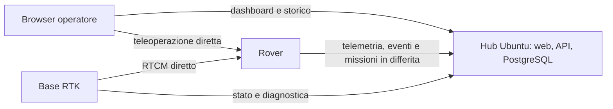

# Hub Ubuntu per Rover, Base e futuri dispositivi

**Stato al 28 novembre 2026.** Il servizio operativo di API, PostgreSQL e dashboard è nel repository HP-linux. Il 27 novembre l'operatore ha verificato il pulsante di avvio su richiesta del Rover e il ritorno al FIX da fermo. Per l'installazione usa la [guida HP-linux](../../HP-linux/docs/registrare-rover.md#avvio-su-richiesta). La [fase 2](fase-2-hub-ubuntu.md) resta la procedura per il prototipo con dispositivi simulati. La misura di latenza e percorso di rete della [fase 1](fase-1-hub-ubuntu.md) resta aperta.

## Obiettivo

Un PC Ubuntu acceso durante l'uso ospiterà API, archivio e dashboard web per Rover, Base RTK e futuri dispositivi. I dati applicativi resteranno sul PC dell'operatore invece di essere caricati su Supabase. La dashboard mostrerà stato attuale, ultima posizione con timestamp, cronologia, missioni e qualità dei collegamenti. Il server web resterà attivo come servizio: non serve lasciare aperta una scheda del browser.

Il PC coordinerà inventario, stato e associazione tra dispositivi. **Non sarà nel percorso obbligatorio dei comandi motore o delle correzioni RTCM.** La guida deve poter continuare con Ubuntu temporaneamente irraggiungibile; il Rover conserverà gli eventi localmente e li invierà dopo il ripristino del collegamento.

## Confini dei flussi

| Flusso | Percorso previsto | Se Ubuntu non risponde |
| --- | --- | --- |
| Comandi manuali e riscontro | Browser operatore → Rover, su connessione diretta protetta | La guida diretta resta disponibile se operatore e Rover si raggiungono; valgono i controlli di arresto locali. |
| Video live | Rover → browser, separato dall'archivio | Lo stream diretto può continuare. Il video continuo non viene scritto nel database. |
| Correzioni RTK | Base → Rover via RTCM/TCP privato | Il flusso può continuare se Base e Rover si raggiungono. |
| Stato e dati storici | Rover/Base → API Ubuntu → PostgreSQL | La dashboard centrale mostra l'ultimo dato con la sua età. I dispositivi conservano una coda locale dei dati da ritrasmettere. |
| Configurazione di missione | Dashboard → dispositivo, con versione e conferma esplicita | Nessuna modifica implicita alle missioni attive; il controllore usa solo la configurazione locale validata. |

Il database non riceverà connessioni dirette dai robot: un'API autenticata convaliderà e registrerà i messaggi. Ogni dispositivo avrà un'identità stabile. Il server assegnerà `received_at` per distinguere l'ora di ricezione dall'ora di misura. Gli invii ripetuti dopo una disconnessione saranno deduplicati tramite `device_id`, `boot_id` e `sequence`. La specifica iniziale è nella [fase 1](fase-1-hub-ubuntu.md#contratto-dati-proposto).

## Rapporto con il software attuale

- `telemetry_server.py` pubblica telemetria WebSocket a circa 5 Hz, registra punti GNSS durante una missione a circa 1 Hz e può inviare uno stato HTTP alla Base a circa 1 Hz. Il client RTCM usa direttamente l'host della Base. Questi flussi restano separati nella migrazione.
- `static/autopilota.html` apre oggi `/ws` sullo stesso host della pagina. La prima dashboard Ubuntu offrirà un collegamento alla pagina del Rover. Per integrare la guida nella pagina centrale serviranno un endpoint Rover configurabile e HTTPS/WSS sul collegamento diretto.
- `../boyz-antenna-main/base_manager.py` espone RTCM/TCP e una piccola API con archivio SQLite per ultima posizione Base/Rover. Il nuovo hub non deve interrompere questa coppia prima che i flussi sostitutivi siano verificati.
- `netlify.toml` e `static/runtime-config.js` descrivono l'opzione attuale di frontend statico Netlify. Il progetto Ubuntu la rende facoltativa: la dashboard centrale sarà servita dal PC locale.

La teleoperazione può essere rallentata dalla rete tra operatore e Rover, compresi eventuali relay Tailscale, ma non dalla scrittura nel database se i due percorsi restano indipendenti. Un upload o una scrittura lenti non devono bloccare il ciclo WebSocket o il driver motori. Il valore **PING** in Autopilota è l'età della telemetria, non il tempo di andata e ritorno del comando; usare la misura **INPUT → ROVER** per il confronto dei comandi.

## Servizi previsti su Ubuntu

1. **API di acquisizione:** riceve messaggi versionati e autenticati, impone limiti di dimensione, convalida unità e timestamp e restituisce conferma solo dopo la persistenza.
2. **PostgreSQL:** conserva catalogo dispositivi, misure, eventi, indici di missione e ultime posizioni. La prima versione usa tabelle semplici e indici su dispositivo e tempo; partizionamento e broker sono decisioni successive basate sul volume misurato.
3. **Dashboard:** mostra online/offline in base all'età dell'ultimo messaggio ricevuto, qualità GNSS/RTCM, posizione corrente o ultima nota e collegamenti alle interfacce dirette. Una posizione vecchia deve conservare il proprio timestamp e non apparire live.
4. **Gestione operativa:** avvio automatico con `systemd`, accesso privato tramite Tailscale, backup su un secondo supporto, verifica periodica del ripristino e monitoraggio di spazio, errori di ingestione e coda dei dispositivi.

Tailscale evita di esporre direttamente le porte del Rover e del database su Internet, ma usa un servizio esterno per coordinare la rete. Non è un archivio Supabase dei dati applicativi. Se in futuro si richiederà indipendenza anche dal piano di controllo Tailscale, andrà progettata una VPN gestita in proprio con un endpoint raggiungibile.

## Crescita e limiti

Il catalogo deve distinguere Rover, Base e nuovi tipi senza aggiungere colonne specifiche per ogni dispositivo alla tabella principale. Per più antenne, l'hub potrà proporre un'associazione Base–Rover, ma il Rover dovrà mantenere localmente l'associazione scelta e ricevere RTCM direttamente dalla Base. Cambiare Base durante una corsa richiede una verifica della coerenza del riferimento GNSS; non è una commutazione automatica della prima versione.

Prima di dimensionare il PC per molti Rover, misurare numero di dispositivi, frequenza e dimensione dei messaggi, giorni di conservazione, missioni e video. I flussi video continui restano fuori da PostgreSQL. La perdita del PC Ubuntu interrompe dashboard e archivio centrale in tempo reale, quindi il backup dei dati e la coda locale dei dispositivi sono requisiti operativi.

## Stato dell'HP nella dashboard

La scheda **HP Ubuntu · Online** indica che il servizio web dell'HP risponde e riesce a leggere PostgreSQL. La pagina è raggiungibile finché l'hub è operativo. Il [repository HP-linux](https://github.com/st3oleg/HP-linux) contiene la configurazione e la procedura di avvio.

## Sviluppi futuri

Come estensione del monitoraggio, aggiungere una vista **Accessi** separata dalle schede dei dispositivi. La prima versione potrà registrare gli accessi alla dashboard dell'HP. Per coprire gli accessi diretti, ciascun Rover o antenna dovrà inviare all'hub i propri eventi con identità disponibile, servizio e ora. Definire permessi di consultazione e durata della conservazione. I comandi di guida e le correzioni RTCM manterranno il percorso diretto.

## Sequenza di esecuzione

Il codice locale del Rover può accodare lo stato GNSS/RTCM e gli indici delle nuove missioni in SQLite. Per abilitarlo, configura `ROVER_HUB_URL` con l'URL HTTPS di `/api/v1/events`, `ROVER_HUB_DEVICE_ID` con l'identità registrata sull'hub e `ROVER_HUB_TOKEN` con il token assegnato. Il percorso del database locale è configurabile con `ROVER_HUB_OUTBOX`. Senza URL, l'invio resta disattivato. I file delle missioni restano sul Rover.

La coda rimuove un evento dopo la conferma di scrittura o di duplicato. Il limite iniziale è di 10.000 eventi pendenti. A coda piena gli eventi già in coda restano disponibili e il Rover segnala gli accodamenti falliti nel log.

Il collaudo del 27 novembre 2026 ha usato il mittente Rover, HTTPS locale, l'API dell'hub e PostgreSQL 17. Con indisponibilità HTTP 503, perdita simulata di una conferma e riavvio del mittente, sono stati recuperati due eventi distinti, uno di stato e un indice missione. PostgreSQL ha conservato una sola riga per evento. Resta da ripetere la prova con Rover e HP fisici e un'interruzione effettiva dell'hub.

| Fase | Risultato richiesto |
| --- | --- |
| 1. Misure e contratto dati | Inventario verificato, baseline della latenza diretta, stima dei volumi e schema versionato condiviso. Vedere [fase 1](fase-1-hub-ubuntu.md). |
| 2. Hub in sola lettura | Ubuntu su Tailscale, API e database attivi, dashboard con Rover e Base, backup e ripristino provati. Nessuna modifica al percorso di guida. |
| 3. Sincronizzazione | Invio dati da Rover e Base con coda locale, retry e deduplicazione; prova con Ubuntu spento e riacceso. |
| 4. Portale di controllo | Collegamento diretto al Rover dalla dashboard; solo dopo misura della latenza, integrazione della teleoperazione nella stessa pagina con autorizzazione e operatore unico. |
| 5. Più dispositivi | Registrazione e permessi per nuove Base/Rover, associazioni e politiche di conservazione; introdurre un broker solo se il carico lo richiede. |

Prima di rendere accessibile la teleoperazione oltre la rete privata, correggere l'assenza di autenticazione del WebSocket e la condivisione del heartbeat fra client, descritti in [Analisi del codice](analisi-codice.md#vulnerabilità-e-guasti-prioritari). L'hub non sostituisce i controlli locali di arresto, geofence e presenza dell'operatore.
