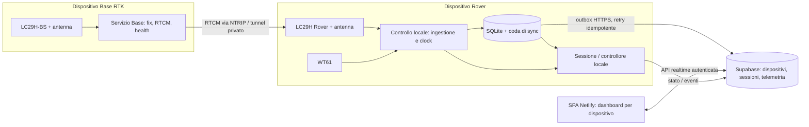

# Piano di unificazione GCS / Rover / Base RTK

**Stato:** piano preliminare storico, riferito al checkout esaminato prima dell'aggiunta del client RTCM, dell'anteprima della traccia e del controllore da terminale. La sezione «architettura osservabile» sotto conserva quella fotografia; per il software attuale vedere [Analisi del codice](analisi-codice.md) e [Riproduzione traccia](riproduzione-traccia.md). La nuova direzione per l'archivio è il [PC Ubuntu](hub-ubuntu.md) al posto di Supabase. Nessuna modifica al codice, alle schede Raspberry o a Supabase fa parte di questo piano.

## 1. Perimetro e qualità delle evidenze

Ho potuto verificare direttamente il progetto presente in `boyz-terminator-main`: server aiohttp, lettori GPS/IMU, driver motori, quattro pagine statiche e script dimostrativi. Ho letto anche i requisiti riportati nel testo incollato e le successive richieste di geofencing e diagnostica Scatter.

Il testo descrive un secondo progetto GCS/Cloud basato su Netlify e Supabase, con `rover_manager.py`, `base_manager.py`, SQLite, pagine registrazioni/riproduzione e schema cloud; tali sorgenti, configurazioni di deploy e schema Supabase non sono presenti nel workspace esaminato. Non posso quindi certificare come funzionino davvero né pianificare migrazioni puntuali prima di averli ricevuti. Le righe relative a quel progetto in questo documento sono ipotesi ricavate dal report incollato.

Il documento incollato contiene credenziali Wi-Fi e credenziali di accesso in chiaro. Non le copio qui né le considero configurazione da portare nel codice. Vanno cambiate prima di continuare: in particolare le password Wi-Fi e Raspberry eventualmente ancora attive, insieme a qualunque credenziale riutilizzata.

## 2. Analisi dell'architettura osservabile

### Progetto disponibile nel workspace

- `telemetry_server.py` gira su un singolo Raspberry: espone HTTP/WebSocket, invia telemetria GPS/IMU, controlla due motori, registra tracce JSON e avvia `ustreamer`.
- `modules/gps.py` legge NMEA da `/dev/ttyS0`, dichiarato a 115200 baud; `modules/imu.py` legge angoli WT61 da `/dev/ttyAMA4`; `modules/motor.py` emette segnali per un Cytron MDDS30.
- Le pagine HTML si collegano direttamente al server; il nome “Autopilota” non corrisponde a una logica di navigazione autonoma.
- La mappa consente ora di creare/modificare/eliminare poligoni autorizzati, salvati nel `localStorage` del browser. Il server e il controllore non li ricevono, quindi il geofence non limita i comandi né il movimento. Il requisito è consentire autonomia solo entro i confini autorizzati e mantenere disponibile il manuale fuori area.
- La pagina Scatter accumula la posizione Rover tramite WebSocket; non riceve campioni Base perché il payload corrente pubblica coordinate Base a zero.
- Non risultano nel progetto disponibile: client RTCM/NTRIP, bridge con Base, database locale/cloud, code di sincronizzazione, schema multi-dispositivo, encoder, acquisizione completa IMU, pianificatore automatico, stato batteria, enforcement geofence a bordo o stop di sicurezza indipendente.
- Interfacce WebSocket e video non mostrano autenticazione/TLS. I comandi motore, il dry-run e la registrazione sono quindi un rischio se le porte sono raggiungibili da una rete non fidata.

### Secondo progetto descritto nel testo incollato

Il report lo descrive come due demoni (Rover e Base), buffer SQLite sul Rover, sincronizzazione Supabase, frontend Netlify/Leaflet e correzioni RTCM su rete privata/Tailscale. Il report menziona anche pagine di archivio/playback e funzioni implementate, ma senza sorgenti non è possibile verificare: protocolli e porte effettivi, schema SQL e policy RLS, segreti Netlify, formato/retention del buffer, gestione duplicati, ordinamento timestamp, stato dei servizi systemd, firmware e comandi Quectel realmente inviati.

### Discrepanze da risolvere

1. Il repository corrente salva JSON e parla WebSocket diretto; il report dell'altro progetto dichiara SQLite + Supabase REST/cloud. Sono due architetture distinte, non ancora un unico sistema.
2. Il codice corrente è a 115200 baud per GPS; alcune note storiche menzionano 460800. Il baud va deciso sulla variante e firmware effettivi, verificato elettricamente e salvato in configurazione.
3. L'obiettivo richiede Rover LC29H-DA a 10 Hz RTK; la specifica ufficiale Quectel consultata dichiara per DA aggiornamento RTK a **1 Hz**, mentre EA è dichiarato a 1–10 Hz. La scelta del ricevitore va chiusa prima di fissare il requisito 10 Hz. [Specifiche LC29H Quectel](https://www.quectel.com/content/uploads/2024/03/Quectel_LC29H_Series_GNSS_Specification_V1.7.pdf?wpId=114208)
4. La frequenza massima dell'IMU e il significato di “tutti i dati” dipendono dall'output configurato del WT61: il driver corrente interpreta solo il frame angolare `0x55 0x53` e non registra accelerazioni o payload completi.
5. “Internet obbligatorio per avviare” convive con “continuare offline e sincronizzare”: è coerente se Internet è un prerequisito al solo avvio/sessione e la registrazione già avviata continua localmente per una finestra temporanea.
6. Il testo chiede di interrompere il programma dopo due minuti offline. Si propone di chiudere in sicurezza la sessione e fermare l'acquisizione missione, mantenendo acceso il servizio di stato/recupero: spegnere il demone riduce osservabilità e possibilità di riconnessione. Questo comportamento va confermato nella specifica.

## 3. Architettura obiettivo proposta

Supabase serve per identità, sessioni, telemetria, stato e archivio; non come trasporto del flusso RTCM in tempo reale. Il percorso correzioni dovrebbe restare un canale dedicato Base→Rover (NTRIP privato o tunnel autenticato), con controllo di età e stato delle correzioni. La registrazione primaria avviene su SQLite sul Rover e una coda durevole sincronizza Supabase in modo idempotente.

I poligoni creati dalla console devono essere trasferiti e versionati come configurazione autorizzata sul Rover. Il controllore locale deve verificarli prima e durante ogni missione autonoma, applicare un margine coerente con errore GNSS, ingombro e arresto e passare allo stato sicuro se i limiti vengono superati o la localizzazione è incerta. In modalità manuale il superamento del confine può essere permesso solo con comando esplicito dell'operatore. Non affidare questo vincolo alla sola UI o alla rete.

La Base non ospita IMU. Ogni record porta `device_id`, timestamp UTC, timestamp monotono locale, `session_id` se applicabile, tipo/modulo, qualità e versione schema. Rover e Base hanno identità separate; la Base registra lo stato e la posizione di inizio/fine sessione, mentre il Rover registra i campioni GNSS/IMU. Per il timestamp comune: sincronizzazione NTP/chrony e, se compatibile con l'hardware finale, valutazione 1PPS; archiviare anche il tempo monotono per misurare drift e ordinare campioni offline.

## 4. Gap analysis

| Area | Disponibile e verificato | Mancante per l'obiettivo |
|---|---|---|
| Dispositivi | Un backend rover teleoperato; codice lettori e GPIO. | Sorgenti della Base e del secondo GCS, identità multi-device, heartbeat/health verificati. |
| GNSS/RTK | Parsing GGA/RMC locale sul rover corrente. | Config Quectel verificata per firmware/revisione, correzioni RTCM, NTRIP privato, misure di latenza/fix, scelta modulo per requisito 10 Hz. |
| IMU | WT61 su UART4, frame angoli. | Recupero di tutti i frame e dati richiesti, frequenza effettiva, calibrazione, clock comune, driver unico sul Rover. |
| Persistenza | JSON traccia nel progetto corrente; il report dichiara SQLite nel secondo. | Verifica sorgenti SQLite, schema dati unificato, buffer durevole, limiti spazio, deduplica e sync offline verificabile. |
| Cloud | Supabase menzionato nel report, non ispezionabile nel workspace. | SQL/migrazioni, policy RLS, Auth per dispositivi e utenti, indici/partizionamento, API e realtime. |
| Web | UI statica Leaflet/teleop nel progetto corrente. | SPA unica device-centric, integrazione Netlify reale, selettore dinamico, archivio e playback conservati. |
| Rete/secret | Note Tailscale e credenziali testuali nel testo. | Gestione sicura segreti, rotazione, onboarding Wi-Fi, accesso least-privilege, rotazione chiavi, firewall, TLS e audit. |
| Errori/offline | Watchdog solo comandi motore nel codice corrente. | Stato errori tipizzato, timer 5 s UI, buffer fino a 2 min richiesto, chiusura sessione e riallineamento al reconnect. |
| Sicurezza macchina | Nessuna catena indipendente nel repository. | Valutazione dei rischi, E-stop, arresto attrezzo, protezioni, requisiti e test; separata dalla dashboard di rilievo. |

**Ambito importante:** i requisiti presenti sono per un sistema di rilievo GPS/IMU e registrazione, non per il robot autonomo di sfalcio discusso nella documentazione precedente. La guida vettoriale di playback descritta nello storico guida l'operatore e non deve essere trasformata in navigazione autonoma senza una specifica e una valutazione di sicurezza distinte.

## 5. Piano di implementazione proposto

| Fase | Attività | Risultato verificabile / criterio di uscita |
|---|---|---|
| 0. Raccolta e inventario | Acquisire il secondo repository, migrazioni/schema Supabase, configurazione Netlify senza segreti, servizi systemd, versione OS, inventario board GNSS/moduli/firmware. Mappare endpoint, processi, porte, flussi e dipendenze. | Diagramma “as-is” di entrambi i progetti e matrice sorgente/configurazione verificata. Nessuna modifica ancora. |
| 1. Specifiche e decisioni | Confermare 10 Hz richiesti vs LC29H-DA 1 Hz RTK; scegliere modello/firmware; definire clock, offline timeout, comportamento Base, confini dei dati e compatibilità delle funzioni attuali. | ADR firmate e criteri numerici di accettazione; dipendenze hardware non ambigue. |
| 2. Sicurezza e segreti | Ruotare password esposte; definire vault/env, chiavi distinte per Base/Rover, Supabase Auth/RLS, TLS, Tailscale/ACL/firewall e threat model. | Nessuna credenziale nei repository/log; accesso negato per device non registrati; prova di revoca credenziali. |
| 3. Modello dati e protocollo | Definire schema versionato: devices, sessions, GNSS, IMU, health/events, base session positions; unità, timestamp, idempotency key e retention. Definire protocollo RTCM separato. | Migrazioni SQL e API documentate, test di RLS su ruoli utente/device e replay di una coda duplicata senza doppie righe. |
| 4. Servizi embedded | Modularizzare agenti Base e Rover; configurazione centralizzata; Base automatica; ingest GNSS/IMU e timestamp; SQLite outbox; upload a blocchi e retry; modalità offline e chiusura sessione. | Prove su banco senza rete e su reconnect: nessun campione perso/duplicato entro il budget; Base invia correzioni valide; errori osservabili. |
| 5. Frontend unificato | SPA device-centric Netlify; auth; selettore dispositivi; stato connessione/errore con timer 5 s; live map, grafici, sessioni, playback, pannello Base e mantenimento funzioni correnti utili. | Matrice UI/API per Rover/Base, viewport stabile, gestione reconnect e permessi provati. |
| 6. Deploy e operatività | Unità systemd least-privilege, restart policy, health checks, configurazione Wi-Fi guidata, aggiornamenti/rollback, backup SQLite e guide operatore. | Installazione ripetibile su immagini pulite e procedure di recovery testate per entrambi i Raspberry. |
| 7. Validazione sul campo | Test RTK statico/dinamico e sky-view, perdita rete 5 s/2 min, disconnessione RTCM, restart/crash, drift clock, saturazione disco e carico 100 Hz IMU. | Report con misure reali, limiti operativi e checklist di rilascio; nessun deploy automatico. |

### Rischi e mitigazioni

- **Secondo progetto non disponibile:** rischio di duplicare o rompere funzioni già esistenti. Mitigazione: fase 0 obbligatoria prima di scegliere cosa riusare.
- **GNSS update rate non conforme:** DA documentato a 1 Hz RTK, non 10 Hz. Mitigazione: scelta del ricevitore prima della progettazione del campionamento e del controller.
- **Dati offline e timestamp non coerenti:** mismatch/duplicati tra SQLite e cloud. Mitigazione: outbox, identificatori deterministici, timestamp UTC + monotono, sync idempotente.
- **Schema cloud con accesso troppo ampio:** esposizione o modifica telemetria/sessioni. Mitigazione: RLS per proprietario/device, separare client key pubblica da segreti server e testare ogni policy.
- **Credenziali già esposte nel testo:** accesso indesiderato a Wi-Fi/dispositivi se ancora valide. Mitigazione: rotazione prima di collegare servizi cloud o condividere altro codice.
- **Internet confuso con servizio operativo:** arrestare tutto il processo rende impossibile health reporting/reconnect. Mitigazione: terminare la sessione di acquisizione al timeout, lasciare health agent attivo se confermato.
- **Rilievo confuso con robot tagliaerba:** requisiti di sicurezza e modalità autonome molto diversi. Mitigazione: mantenere il presente piano sul rilievo; aprire un safety case e piano separati per trazione autonoma/lama.

## 6. Decisioni richieste per avviare lo sviluppo

1. Approvare o correggere l'architettura proposta e il piano per fasi.
2. Confermare se, dopo 2 minuti senza Internet, si deve terminare solo la sessione di acquisizione mantenendo health/reconnect attivi (raccomandato) oppure arrestare l'intero servizio.
3. Fornire il secondo repository (o percorso workspace) e, se applicabile, schema/migrazioni Supabase e configurazione Netlify redatti da segreti. Senza questo materiale potrò implementare solo il progetto attualmente disponibile, non l'unificazione dichiarata.
4. Confermare il modello GNSS reale e dare priorità al requisito frequenza/precisione: LC29H-DA ha aggiornamento RTK nominale 1 Hz nella specifica ufficiale consultata; non impostare 10 Hz come assunto valido per DA.

